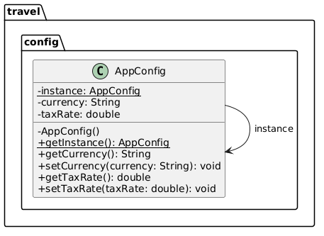
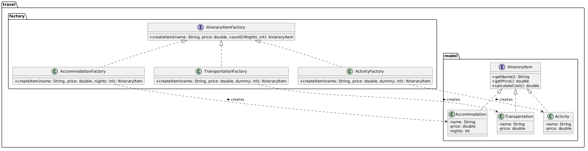
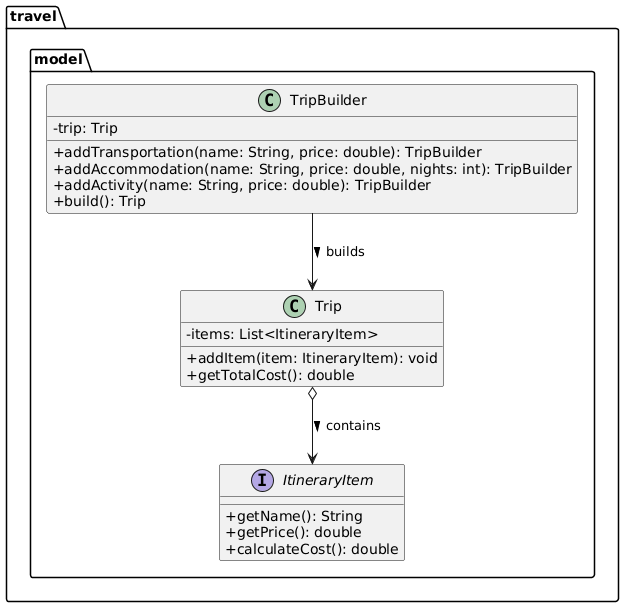

# Laboratory Work #1:  Creational Design Patterns

**Topic:** Trip Itinerary Builder  
**Language:** Java  
**Environment:** IntelliJ IDEA  
**Group:** FAF-243   
**Student Name:** Daria Tureac

---

## 1. Project Overview

The **Trip Itinerary Builder** is a modular Java console application designed to manage complex travel planning, expense tracking, and budget calculations. Building upon the SOLID-compliant architecture established in Laboratory Work #1, this second iteration focuses on optimizing object creation mechanisms using Creational Design Patterns.

By decoupling object instantiation from client logic, the application achieves higher flexibility, eliminates direct `new` operator dependencies in business workflows, and simplifies complex object assembly.

## 2. Implemented Creational Patterns

The application integrates three core Creational Design Patterns:

1. **Singleton Pattern** (`AppConfig`): Manages global application settings (such as base currency and system tax rates) in a single, globally accessible instance.

2. **Builder Pattern** (`TripBuilder`): Encapsulates the step-by-step construction of complex Trip objects using a fluent interface.

3. **Factory Method Pattern** (`ItineraryItemFactory` Hierarchy): Provides an abstract creation interface for generating various travel expense items (`Accommodation`, `Transportation`, `Activity`) without tightly coupling code to concrete classes.


## 3. Detailed Pattern Breakdown & Code Snippets

**A. Singleton Pattern (travel.config.AppConfig)**

**Intent**: Ensure a class has only one instance, and provide a global point of access to it.

Architecture & Benefits:

* The constructor is marked `private` to block direct instantiation via `new`.

* A thread-safe `getInstance()` method manages lazy initialization.

* Centralizes system-wide configuration data (currency, tax rate) to avoid inconsistent application state.



#### Code Snippet
```java
package travel.config;

public class AppConfig {
    private static AppConfig instance;
    private String currency = "USD";
    private double taxRate = 0.05; // 5% default tax rate

    // Private constructor prevents direct instantiation
    private AppConfig() {}

    // Global access point with lazy initialization
    public static synchronized AppConfig getInstance() {
        if (instance == null) {
            instance = new AppConfig();
        }
        return instance;
    }

    public String getCurrency() { return currency; }
    public void setCurrency(String currency) { this.currency = currency; }

    public double getTaxRate() { return taxRate; }
    public void setTaxRate(double taxRate) { this.taxRate = taxRate; }
}
```

**B. Factory Method Pattern (travel.factory)**

**Intent**: Define an interface for creating an object, but let subclasses decide which class to instantiate.

Architecture & Benefits:

* `ItineraryItemFactory` serves as the abstract creator interface.

* Concrete factories (`AccommodationFactory`, `TransportationFactory`, `ActivityFactory`) encapsulate the instantiation logic for specific domain items.

* Adheres strictly to the Open/Closed Principle (OCP): Adding new expense types requires creating a new factory without modifying existing creation logic.


#### Code Snippets:

**Creator Interface**
```java
package travel.factory;

import travel.model.ItineraryItem;

public interface ItineraryItemFactory {
    ItineraryItem createItem(String name, double price, int countOrNights);
}
```

**Concrete Factory Example** (`AccommodationFactory.java`):
```java
package travel.factory;

import travel.model.Accommodation;
import travel.model.ItineraryItem;

public class AccommodationFactory implements ItineraryItemFactory {
    @Override
    public ItineraryItem createItem(String name, double price, int nights) {
        return new Accommodation(name, price, nights);
    }
}
```

**C. Builder Pattern (travel.model.TripBuilder)**

**Intent**: Separate the construction of a complex object from its representation so that the same construction process can create different representations.

Architecture & Benefits:

* Hides the internal assembly steps of the complex `Trip` aggregate object.

* Integrates with Factory Methods internally to create domain items before attaching them to the trip.

* Provides a clean, readable Fluent Interface (`builder.addTransportation(...).addAccommodation(...).build()`).



#### Code Snippet:
```java
package travel.model;

import travel.factory.AccommodationFactory;
import travel.factory.ActivityFactory;
import travel.factory.TransportationFactory;

public class TripBuilder {
    private final String destination;
    private final Trip trip;

    public TripBuilder(String destination) {
        this.destination = destination;
        this.trip = new Trip(destination);
    }

    public TripBuilder addTransportation(String type, double price) {
        TransportationFactory factory = new TransportationFactory();
        trip.addItem(factory.createItem(type, price, 0));
        return this;
    }

    public TripBuilder addAccommodation(String name, double pricePerNight, int nights) {
        AccommodationFactory factory = new AccommodationFactory();
        trip.addItem(factory.createItem(name, pricePerNight, nights));
        return this;
    }

    public TripBuilder addActivity(String name, double fee) {
        ActivityFactory factory = new ActivityFactory();
        trip.addItem(factory.createItem(name, fee, 0));
        return this;
    }

    public Trip build() {
        return trip;
    }
}
```

## 4. Complete Package Hierarchy

```
 src/
        └── travel/
        ├── config/
        │   └── AppConfig.java                 <-- Singleton
    ├── factory/                           <-- Factory Method Pattern
    │   ├── ItineraryItemFactory.java
    │   ├── AccommodationFactory.java
    │   ├── TransportationFactory.java
    │   └── ActivityFactory.java
    ├── model/
        │   ├── ItineraryItem.java
    │   ├── Accommodation.java
    │   ├── Transportation.java
    │   ├── Activity.java
    │   ├── Trip.java
    │   └── TripBuilder.java               <-- Builder Pattern
    ├── printer/
        │   ├── ItineraryPrinter.java
    │   └── ConsoleItineraryPrinter.java
    ├── service/
        │   ├── CostCalculator.java
    │   └── TripService.java
    └── Main.java                          <-- Interactive Client

```

## 5. Conclusion

By integrating Creational Design Patterns into the Trip Itinerary Builder:

1. Instantiation Control: Direct reliance on `new` operator calls is encapsulated inside factories and builders.

2. Object Assembly Flexibility: Complex itineraries are incrementally constructed using `TripBuilder` without cluttering domain classes.

3. Global Consistency: `AppConfig` ensures global settings remain standardized throughout the application execution lifecycle.