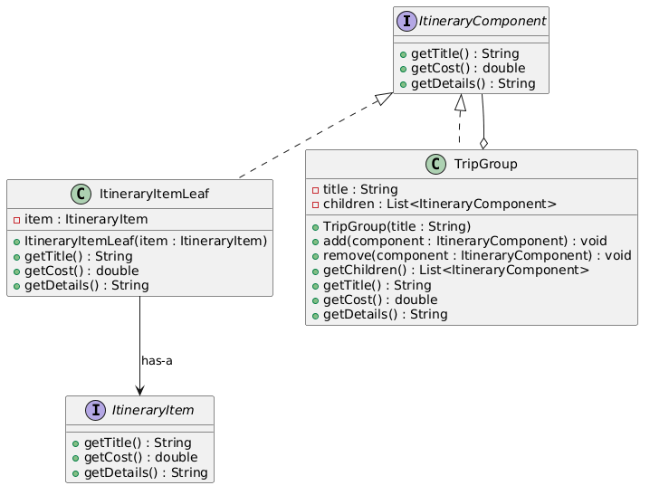
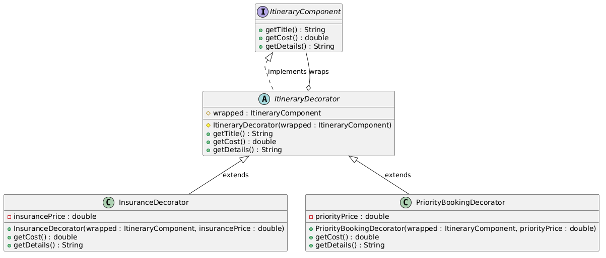
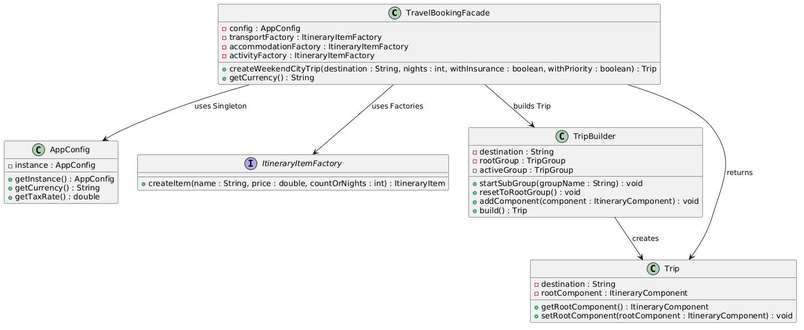

# Laboratory Work #2: Structural Design Patterns

**Topic:** Trip Itinerary Builder  
**Language:** Java  
**Environment:** IntelliJ IDEA  
**Group:** FAF-243   
**Student Name:** Daria Tureac

---

## 1. Project Overview

The **Trip Planner** application is a console-based travel itinerary management system built on top of the creational patterns from Laboratory Work No. 1 (`AppConfig` Singleton, `ItineraryItemFactory` Factory Method implementations, and `TripBuilder`). Users can interactively construct travel itineraries for a destination by creating individual travel items (transportation, accommodation, and activities), organizing them into nested logical groups (such as days or activity bundles), dynamically attaching optional add-ons like travel insurance and priority booking, and generating pre-configured weekend packages with automatic subtotal, tax, and final budget calculations.

## 2. Structural Design Patterns Overview & Creational Context

The application integrates three core **Structural Design Patterns** (`Composite`, `Decorator`, and `Facade`) while preserving and interacting with the creational patterns from Laboratory Work No. 1:

1. **Composite Pattern** (`ItineraryComponent`, `ItineraryItemLeaf`, `TripGroup`): Treats individual itinerary items and nested groups/sub-groups uniformly through a shared `ItineraryComponent` interface, aggregating costs and formatted details recursively.


2. **Decorator Pattern** (`ItineraryDecorator`, `InsuranceDecorator`, `PriorityBookingDecorator`): Dynamically attaches optional services (such as travel insurance and priority booking) onto any `ItineraryComponent` at runtime in any combination without altering existing domain or composite classes.


3. **Facade Pattern** (`TravelBookingFacade`): Provides a simplified entry point that coordinates factories, `TripBuilder`, `TripGroup` composite hierarchies, optional decorators, and global configuration (`AppConfig`) behind high-level operations.


## 3. Detailed Pattern Breakdown, Diagrams & Unit Tests

### 3.1. Composite Pattern (`travel.composite.TripGroup`, `travel.composite.ItineraryItemLeaf`)

**Intent**: Compose objects into tree structures to represent part-whole hierarchies and allow clients to treat individual objects and compositions of objects uniformly.

**Architecture & Benefits**:
* Both `ItineraryItemLeaf` (wrapping an `ItineraryItem`) and `TripGroup` (holding a list of `ItineraryComponent` children) implement `ItineraryComponent`, preventing `instanceof` checks in client code.
* Nested `TripGroup` instances support multi-level itineraries (such as days or activity categories) while summing costs and rendering details recursively.
#### a. Class Diagram




#### b. Code Snippet

**Source**: `src/travel/composite/TripGroup.java`

```java
public class TripGroup implements ItineraryComponent {
    private final String title;
    private final List<ItineraryComponent> children = new ArrayList<>();

    public TripGroup(String title) {
        this.title = title;
    }

    public void add(ItineraryComponent component) {
        children.add(component);
    }

    @Override
    public double getCost() {
        double sum = 0.0;
        for (ItineraryComponent child : children) {
            sum += child.getCost();
        }
        return sum;
    }

    @Override
    public String getDetails() {
        StringBuilder sb = new StringBuilder();
        sb.append(String.format("Group [%s] (Subtotal: $%.2f)", title, getCost()));
        for (ItineraryComponent child : children) {
            sb.append("\n   - ").append(child.getDetails());
        }
        return sb.toString();
    }
}

```

**Explanation**: `TripGroup` and `ItineraryItemLeaf` implement the common `ItineraryComponent` contract, enabling `TripGroup.getCost()` and `TripGroup.getDetails()` to recursively aggregate both single leaves and nested sub-groups uniformly.

#### c. Unit Tests

**Source**: `test/travel/StructuralPatternsTest.java`

* `leafAndGroupShareCommonComponentInterface` — verifies that an `ItineraryItemLeaf` and a `TripGroup` expose uniform behavior and consistent cost/details through `ItineraryComponent`.


* `nestedTripGroupsSumCostAndIncludeDetails` — verifies that nested `TripGroup` hierarchies sum costs across sub-groups and include all child descriptions in `getDetails()`.


### 3.2.  Decorator Pattern (`travel.decorator.ItineraryDecorator`, `InsuranceDecorator`, `PriorityBookingDecorator`)

**Intent**: Attach additional responsibilities or add-ons to an object dynamically at runtime, providing a flexible alternative to subclassing for extending functionality.

**Architecture & Benefits**:

* `ItineraryDecorator` implements `ItineraryComponent` and holds a reference to a wrapped `ItineraryComponent`, delegating base operations cleanly.


* Concrete decorators (`InsuranceDecorator`, `PriorityBookingDecorator`) can wrap either a single leaf or an entire `TripGroup` in any order, keeping existing classes closed for modification and open for extension.

#### a. Class Diagram

!


#### b. Code Snippet

**Source**: `src/travel/decorator/InsuranceDecorator.java`

```java
public class InsuranceDecorator extends ItineraryDecorator {
    private final double insurancePrice;

    public InsuranceDecorator(ItineraryComponent wrapped, double insurancePrice) {
        super(wrapped);
        this.insurancePrice = insurancePrice;
    }

    @Override
    public double getCost() {
        return super.getCost() + insurancePrice;
    }

    @Override
    public String getDetails() {
        return super.getDetails() + String.format(" + [Travel Insurance: $%.2f]", insurancePrice);
    }
}
```

**Explanation**: `InsuranceDecorator` extends `ItineraryDecorator` and delegates to `super.getCost()` and `super.getDetails()` before adding its own surcharge and description at runtime.

####  c. Unit Tests
**Source**: `test/travel/StructuralPatternsTest.java`

* `decoratorsGiveSameCostInAnyOrder` — verifies that applying `InsuranceDecorator` and `PriorityBookingDecorator` in either order yields the same total cost.


* `decoratorsCanWrapCompositeGroupAndAppendDetails` — verifies that wrapping a `TripGroup` with a decorator adds the extra fee and appends the add-on details without altering the group.

### 3.3. Facade Pattern (`travel.facade.TravelBookingFacade`)

**Intent**: Provide a unified, high-level interface to a set of interfaces in a subsystem, making the subsystem easier to use and reducing coupling between clients and internal components.

**Architecture & Benefits**:

* `TravelBookingFacade` encapsulates wiring between item factories (`TransportationFactory`, `AccommodationFactory`, `ActivityFactory`), `TripBuilder`, `TripGroup` sub-groups, optional decorators, and AppConfig.


* Clients can request a complete weekend trip package in a single call while still having direct access to underlying abstractions when custom composition is needed.

#### a. Class Diagram



#### b. Code Snippet

**Source**: `src/travel/facade/TravelBookingFacade.java`

```java
public Trip createWeekendCityTrip(String destination, int nights, boolean withInsurance, boolean withPriority) {
    TripBuilder builder = new TripBuilder(destination);

    builder.startSubGroup("Arrival & Stay");
    builder.addComponent(new ItineraryItemLeaf(
            transportFactory.createItem("Round-trip Flight", 210.0, 1)
    ));
    builder.addComponent(new ItineraryItemLeaf(
            accommodationFactory.createItem("Central Hotel", 95.0, nights)
    ));

    builder.resetToRootGroup();
    builder.startSubGroup("Activities");
    builder.addComponent(new ItineraryItemLeaf(
            activityFactory.createItem("Walking City Tour", 35.0, 1)
    ));

    Trip trip = builder.build();
    ItineraryComponent component = trip.getRootComponent();

    if (withInsurance) {
        component = new InsuranceDecorator(component, 25.0);
    }
    if (withPriority) {
        component = new PriorityBookingDecorator(component, 15.0);
    }

    trip.setRootComponent(component);
    return trip;
}
```

**Explanation**: `TravelBookingFacade` orchestrates factory creation, `TripBuilder` group construction, and conditional decorator wrapping behind `createWeekendCityTrip`, hiding multi-step subsystem assembly from callers.

#### c. Unit Tests

**Source**: `test/travel/StructuralPatternsTest.java`

* `facadeBuildsPackageWithoutOptionalDecorators` — verifies that `createWeekendCityTrip` constructs the expected base itinerary and cost when insurance and priority flags are false.


* `facadeAppliesInsuranceAndPriorityDecoratorsWhenRequested` — verifies that enabling insurance and priority options wraps the resulting `Trip` root component with both decorators and includes their descriptions.


## 4. Conclusions
   
Integrating structural patterns onto an existing creational codebase required refactoring `Trip` and `TripBuilder` so they operate on `ItineraryComponent` rather than a flat `List<ItineraryItem>`. The hardest part was connecting the patterns cleanly—ensuring `TripBuilder` builds nested `TripGroup` nodes that `TravelBookingFacade` can wrap with `ItineraryDecorator` layers while keeping `ConsoleItineraryPrinter` and `CostCalculator` working smoothly.

If designing this project from scratch, I would adopt a build tool such as Maven or Gradle early on to standardize single-command test runs across environments, and enforce Locale.US when formatting currency strings so decimal separators never vary across operating system locales.
