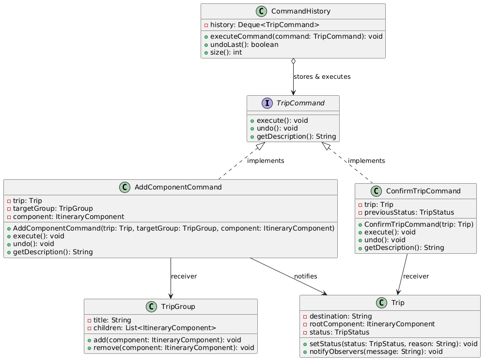
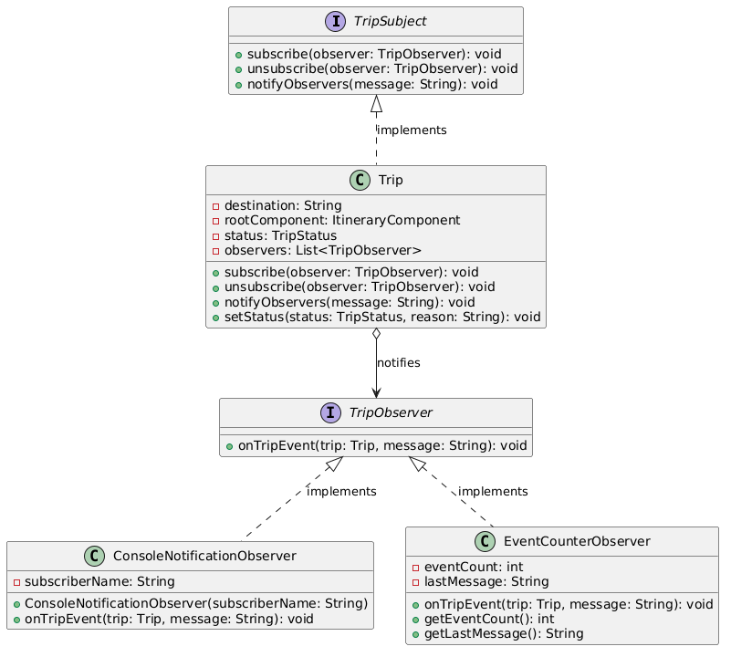
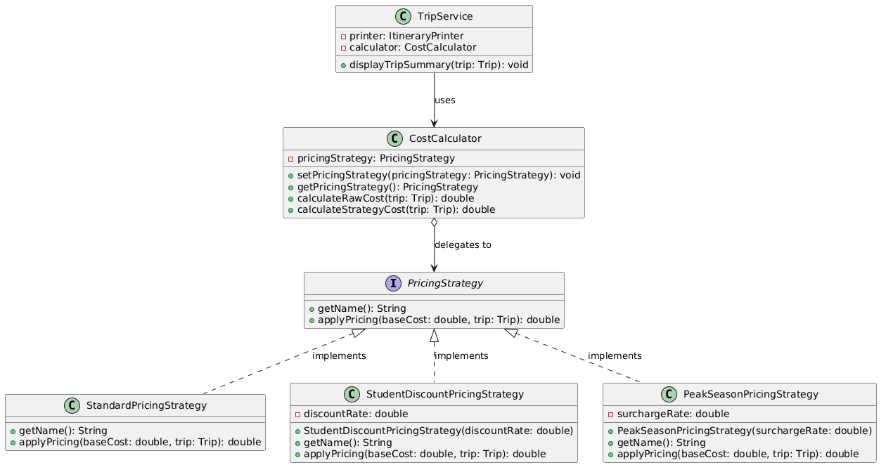
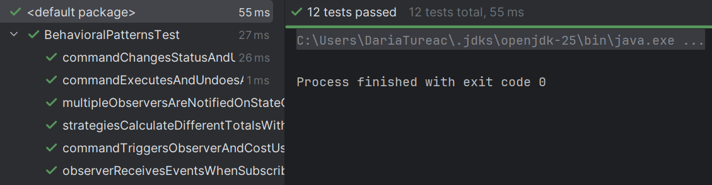

# Laboratory Work #3: Behavioral Design Patterns

**Topic:** Trip Itinerary Builder  
**Language:** Java  
**Environment:** IntelliJ IDEA  
**Group:** FAF-243   
**Student Name:** Daria Tureac

---

## 1. Project Overview

The **Travel Itinerary Planner** application helps travelers organize trips composed of individual items (transportation, accommodation, activities) and nested day/category groups. Building directly upon the creational (Singleton, Builder, Factory Method) and structural (Composite, Decorator, Facade) foundations from Laboratory Works No. 1 and No. 2, this version introduces behavioral patterns to handle reversible itinerary modifications, event-driven status notifications, and runtime pricing rules:
## 2. Behavioral Design Patterns Overview 


1. **Command** encapsulates trip edits and booking confirmation into command objects with undo support.

2. **Observer** notifies subscribed listeners automatically whenever the trip's booking status or itinerary structure changes.

3. **Strategy** allows switching pricing algorithms (Standard, Student Discount, Peak Season) at runtime without modifying the cost calculator.
## 3. Detailed Pattern Breakdown, Diagrams & Unit Tests

### 3.1. Command Pattern


**Intent**: Encapsulates a request or action as an object so it can be parameterized, queued, logged, or undone without coupling the invoker to the concrete receiver logic.

**Architecture and Benefits:**

* **Architecture**: `TripCommand` defines `execute()`, `undo()`, and `getDescription()`. Concrete commands (`AddComponentCommand`, `ConfirmTripCommand`) wrap operations on `TripGroup` (`ItineraryComponent` tree from Lab 2) and `Trip` (`TripStatus`), while `CommandHistory` executes commands and pops them to call `undo()`.


* **Benefits**: Separates menu/invoker code (Main) from receiver mutations (TripGroup, Trip), enables step-by-step rollback (undoLast()), and lets commands notify Trip observers automatically on both execution and undo.

#### a. Class Diagram



#### b. Code Snippet

**Source:** `src/travel/command/AddComponentCommand.java`

```java
public class AddComponentCommand implements TripCommand {
    private final Trip trip;
    private final TripGroup targetGroup;
    private final ItineraryComponent component;

    public AddComponentCommand(Trip trip, TripGroup targetGroup, ItineraryComponent component) {
        this.trip = trip;
        this.targetGroup = targetGroup;
        this.component = component;
    }

    @Override
    public void execute() {
        targetGroup.add(component);
        trip.notifyObservers("Added component '" + component.getTitle() + "' to '" + targetGroup.getTitle() + "'");
    }

    @Override
    public void undo() {
        targetGroup.remove(component);
        trip.notifyObservers("Undid adding component '" + component.getTitle() + "'");
    }
}
```

**Explanation**: `AddComponentCommand` decouples the invoker (`CommandHistory`) from the receivers (`TripGroup` and `Trip`) by storing all context needed to both apply (`execute()`) and reverse (`undo()`) the itinerary change while triggering observer notifications.

#### c. Unit Tests

**Source**: `test/travel/BehavioralPatternsTest.java`

* **commandExecutesAndUndoesAddComponent** (`test/travel/BehavioralPatternsTest.java`): Verifies that executing `AddComponentCommand` adds an `ItineraryItemLeaf` to `TripGroup` and increases group cost, while `CommandHistory.undoLast()` removes it and restores the original cost.


*  **commandChangesStatusAndUndoRestoresPreviousStatus** (`test/travel/BehavioralPatternsTest.java`): Verifies that `ConfirmTripCommand` transitions `TripStatus` from DRAFT to CONFIRMED and `undoLast()` reverts the status back to DRAFT.

### 3.2. Observer Pattern 

**Intent**: Defines a one-to-many dependency between objects so that when one object changes state, all registered observers are notified and updated automatically.


**Architecture and Benefits:**

* **Architecture:** `TripSubject` (`subscribe`, `unsubscribe`, `notifyObservers`) and `TripObserver` (`onTripEvent`) decouple `Trip` from listeners such as `ConsoleNotificationObserver` and `EventCounterObserver`. State or structure updates in `Trip` and commands fan out to active observers through the interface.


* **Benefits:** Keeps `Trip` free of hard-coded console or analytics dependencies, allows subscribing and unsubscribing observers at runtime, and makes adding new listeners possible without touching `Trip`.

#### a. Class Diagram



#### b. Code Snippet

**Source:** `src/travel/model/Trip.java`

```java
@Override
public void subscribe(TripObserver observer) {
    if (observer != null && !observers.contains(observer)) {
        observers.add(observer);
    }
}

@Override
public void unsubscribe(TripObserver observer) {
    observers.remove(observer);
}

@Override
public void notifyObservers(String message) {
    for (TripObserver observer : List.copyOf(observers)) {
        observer.onTripEvent(this, message);
    }
}
```

**Explanation**: `Trip` interacts solely with the `TripObserver` abstraction, supports runtime subscription and unsubscription, and iterates over an immutable copy (`List.copyOf(observers)`) so listener changes during notification cannot cause `ConcurrentModificationException`

#### c. Unit Tests

**Source**: `test/travel/BehavioralPatternsTest.java`

* `observerReceivesEventsWhenSubscribedAndStopsAfterUnsubscribe` (`test/travel/BehavioralPatternsTest.java`): Verifies that an `EventCounterObserver` increments its count when subscribed to `Trip` and stops receiving updates after `unsubscribe()` is called.

* `multipleObserversAreNotifiedOnStateChange` (`test/travel/BehavioralPatternsTest.java`): Verifies that multiple distinct observers subscribed to the same `Trip` all receive the status change event and message payload simultaneously.

### 3.3. Strategy Pattern 

**Intent**: Defines a family of interchangeable algorithms, encapsulates each one, and makes them selectable at runtime independently of the client that uses them.

**Architecture and Benefits:**

* **Architecture**: `PricingStrategy` (`getName`, `applyPricing`) abstracts pricing rules across `StandardPricingStrategy`, `StudentDiscountPricingStrategy`, and `PeakSeasonPricingStrategy`. `CostCalculator` holds a `PricingStrategy` reference and delegates `calculateStrategyCost(trip)` to it before `TripService` applies tax from `AppConfig`.


* **Benefits**: Eliminates if/else or switch pricing branches inside `CostCalculator` and `TripService`, allows switching tariffs dynamically during execution, and lets new discount or seasonal rules be added as new classes without modifying existing ones.

#### a. Class Diagram



#### b. Code Snippet

**Source:** `src/travel/model/Trip.java`

```java
@Override
public void subscribe(TripObserver observer) {
    if (observer != null && !observers.contains(observer)) {
        observers.add(observer);
    }
}

@Override
public void unsubscribe(TripObserver observer) {
    observers.remove(observer);
}

@Override
public void notifyObservers(String message) {
    for (TripObserver observer : List.copyOf(observers)) {
        observer.onTripEvent(this, message);
    }
}
```

**Explanation**: `Trip` interacts solely with the `TripObserver` abstraction, supports runtime subscription and unsubscription, and iterates over an immutable copy (`List.copyOf(observers))` so listener changes during notification cannot cause `ConcurrentModificationException`.

#### c. Unit Tests

**Source**: `test/travel/BehavioralPatternsTest.java`

* `observerReceivesEventsWhenSubscribedAndStopsAfterUnsubscribe` (`test/travel/BehavioralPatternsTest.java`): Verifies that an `EventCounterObserver` increments its count when subscribed to `Trip` and stops receiving updates after `unsubscribe()` is called.


* `multipleObserversAreNotifiedOnStateChange` (`test/travel/BehavioralPatternsTest.java`): Verifies that multiple distinct observers subscribed to the same `Trip` all receive the status change event and message payload simultaneously.

## Passed unit tests



## 4. Conclusions

Integrating behavioral patterns on top of the existing Composite and Decorator hierarchy required careful attention to state consistency during command rollbacks—specifically ensuring `ConfirmTripCommand` captures `previousStatus` before transitioning `Trip` and triggers clean observer notifications on both `execute()` and `undo()`. Using `List.copyOf(observers)` inside `Trip.notifyObservers()` also prevented potential concurrent modification issues when listeners unsubscribe dynamically.

If extending the system further, I would introduce a Memento snapshot mechanism for full multi-step itinerary restoration and a State object hierarchy (DraftState, ConfirmedState, CancelledState) inside `Trip` to enforce valid status transition rules (for example, disallowing itinerary edits once a trip is cancelled).